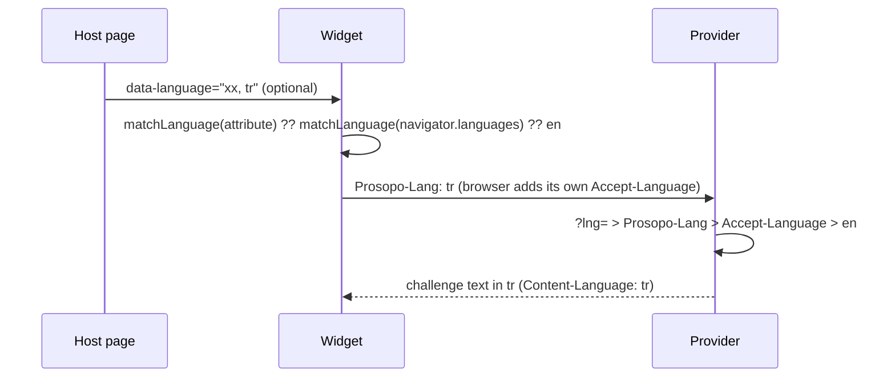

# i18next localization for Prosopo

Translation catalogues (`src/locales/<code>/<namespace>.json`) and the language
negotiation the widget and the provider share.

## Catalogue files

Each language has one file per i18next namespace (`NAMESPACES` in
`src/translationKey.ts`). The browser downloads only what it renders:

| File | Sections | Loaded by |
| --- | --- | --- |
| `widget.json` | WIDGET, API, CAPTCHA, GENERAL, ACCOUNT, DEVELOPER | widget and provider |
| `target.json` | TARGET (image labels) | provider |
| `translation.json` | DATABASE, DATASET, CONTRACT, CONFIG, PORTAL, CLI, FS | provider |

- Keys keep their section prefix, so `TARGET.owl` and `WIDGET.SELECT_ALL` read
  the same whichever file holds them. The provider loads all three with
  `translation` as the default namespace and the others as `fallbackNS`, so
  `t("TARGET.owl")` needs no namespace.
- The widget bundles English `widget.json` and fetches only
  `locales/<code>/widget.json` for another language. It always has English
  text, for its own fallback and for logs and crash reports.
- The provider translates image labels itself, so the browser never needs
  `target.json`. Each captcha in the image challenge carries the translated
  `target`, its `targetKey` and its English `targetEn`, and the response names
  its `language` (`packages/provider/src/api/captcha/localiseTarget.ts`).
- Provider errors carry their key. The widget re-translates keys it has
  (`isWidgetTranslationKey`) and shows the provider's message for the rest. For
  those, the provider also sends `messageEn` (`unwrapError` in
  `packages/common/src/error.ts`), so the widget has English for every string
  it shows. The bundle build copies `widget.json` whole, rather than stripping
  keys its code never names (`packages/procaptcha-bundle/vite.config.ts`).
- `englishText(key)`, `isTranslationKey` and `isTargetKey`
  (`src/serverTranslationKeys.ts`) import every English catalogue, so only
  server code calls them. They read English whatever language i18next is in.
  Code that also runs in the widget, such as `ProsopoError`'s message
  translation, asks the i18n instance instead (`canTranslate`, which uses
  `exists`). That keeps `target.json` and `translation.json` out of the widget
  bundle.
- A section moves between files by moving it in every language. The tests in
  `src/tests/locales.unit.test.ts` and `src/tests/catalogues.test-d.ts` fail on
  a file whose keys differ from English's.

## Choosing the language

One preference list, resolved by one function (`matchLanguage` in
`src/languagePreference.ts`) on both sides:

1. The site's choice: `renderOptions.language`, else the `data-language`
   attribute. Either may list several codes, as in Accept-Language
   (`data-language="xx, tr"`). The first one we have a catalogue for wins. If
   none match, the widget logs an error and falls through to step 2
   (`packages/procaptcha-bundle/src/util/language.ts`).
2. The browser's `navigator.languages`.
3. English.

The widget does not read or write a cookie or local storage. It runs on other
people's sites, so an `i18next` cookie or storage key could clash with the
host's own. Its language comes only from the attribute or the browser.

### Matching a tag to a catalogue (`matchLanguageTag`)

- Case is ignored: `TR-tr` → `tr`.
- A variant falls back to its parent (RFC 4647 lookup): `zh-SG` → `zh`,
  `pt-PT` → `pt`. A variant with its own catalogue keeps it: `pt-BR` →
  `pt-BR`, `zh-CN` → `zh-CN`.
- Traditional Chinese (`zh-TW`, `zh-HK`, `zh-MO`, `zh-Hant-*`) does not fall
  back to `zh`, which is Simplified. The next preference is tried instead, then
  English.
- Aliases for codes we have no catalogue for: `nb` and `nn` → `no`; the
  withdrawn codes `in` → `id` and `jw` → `jv`, which some browsers still send.
- Each parent catalogue (`zh`, `pt`) starts as a copy of its variant. People
  who read the variant generally read the parent too.

## Sending it to the provider

The provider translates the challenge text (the image dataset's labels) itself.
The dataset and its languages then live only on the server. The widget sends
its preference list with every provider request in our own header,
`Prosopo-Lang: tr,en` (`widgetLanguageHeaders`, passed to `ProviderApi` as
default headers). The browser sends its own `Accept-Language` as usual.

The provider (`requestLanguage`, through `createRequestLanguageDetector` in
`src/requestLanguageDetector.ts`) takes the first of these that names a
language we support:

1. The `?lng=` query parameter, for clients that cannot set headers.
2. The `Prosopo-Lang` header.
3. The `Accept-Language` header.
4. Otherwise English.

### Why these headers

- **Prosopo-Lang** carries the site's choice. The widget cannot put it in
  Accept-Language without hiding the browser's own value (below). It is a
  custom header, so it
  triggers a CORS preflight. It is listed in the provider's allowed headers
  (`providerCorsOptions` in `packages/provider/src/api/startProviderApi.ts`).
- **Accept-Language is left to the browser.** The provider still reads it, as
  the fallback when Prosopo-Lang is missing (a proxy dropped it, or a client
  other than the widget). Rejected: setting it from script. The Fetch spec
  allows it, and Chromium 153, Firefox 155 and WebKit 26.6 all sent a scripted
  value unchanged (checked 2026-10-15, docker image
  `mcr.microsoft.com/playwright:v1.63.0-noble`). But the provider's bot rules
  read the raw header (`checkLangRules` in `packages/provider/src/rules/lang.ts`,
  the stored `headers.accept-language`), and a value the widget wrote would
  replace the browser's real one in every request, hiding it from them.
- **Rejected: a cookie.** The provider is a third-party origin, so its cookies
  are often blocked. An `i18next` cookie set on the host site would also clash
  with the site's own i18n.
- **Rejected: the query parameter alone.** It is kept only as a backup.
  Headers keep URLs (and logs, and caches keyed on them) the same for every
  language.

## Why the widget does not use i18next

The provider uses i18next. The widget uses `src/i18nFrontend.ts`, a small
look-up with the same `t` / `changeLanguage` / `on` surface. It fetches
`locales/<code>/widget.json` and fills `{{name}}` placeholders, and does nothing
else. The widget's strings need no plurals, context or nesting (the one count,
`{{count}}` audio digits, is never 1). Image labels are translated by the
provider.

i18next was dropped from the browser in
https://github.com/prosopo/captcha/pull/3310. With its language detector,
HTTP, chained and resources backends and the `cross-fetch` polyfill, it was
23.5 KB gzipped on the render path. That PR cut everything fetched before the
widget renders from 145 KB to 21 KB gzipped.

Measured again on 2026-10-15 (i18next 26.4.2). This was i18next core with a
ten-line fetch backend, no plugins, against `i18nFrontend.ts`. Both were
bundled by esbuild with `minify`, gzip level 9, with `@prosopo/*` and the JSON
catalogues external:

| | minified | gzipped |
| --- | --- | --- |
| i18next core + fetch backend | 43.7 KB | 14.1 KB |
| `i18nFrontend.ts` | 3.5 KB | 1.8 KB |

That is 12.2 KB more on a 21 KB render path for features the widget does not
use, so the widget keeps its own. The two sides still share the parts that
must agree: catalogues, key types (`WidgetTranslationKey`), language matching
(`matchLanguage`) and options (`src/i18SharedOptions.ts`). Revisit this if the
widget needs plurals or context.
