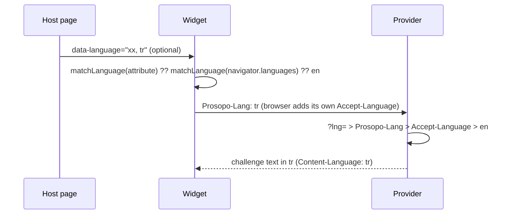

# i18next localization for Prosopo

Translation catalogues (`src/locales/<code>/translation.json`) and the language
negotiation the widget and the provider share.

## Choosing the language

One preference list, resolved by one function (`matchLanguage` in
`src/languagePreference.ts`) on both sides:

1. The site's choice: `renderOptions.language`, else the `data-language`
   attribute. Either may list several codes, as in Accept-Language
   (`data-language="xx, tr"`). The first one we have a catalogue for wins. If
   none match, the widget logs an error and falls through to step 2
   (`packages/procaptcha-bundle/src/util/language.ts`).
2. The browser's `navigator.languages`.
3. English.

The widget does not read or write a cookie or local storage. It runs on other
people's sites, so an `i18next` cookie or storage key could clash with the
host's own. Its language comes only from the attribute or the browser.

### Matching a tag to a catalogue (`matchLanguageTag`)

- Case is ignored: `TR-tr` → `tr`.
- A variant falls back to its parent (RFC 4647 lookup): `zh-SG` → `zh`,
  `pt-PT` → `pt`. A variant with its own catalogue keeps it: `pt-BR` →
  `pt-BR`, `zh-CN` → `zh-CN`.
- Traditional Chinese (`zh-TW`, `zh-HK`, `zh-MO`, `zh-Hant-*`) does not fall
  back to `zh`, which is Simplified. The next preference is tried instead, then
  English.
- Aliases for codes we have no catalogue for: `nb` and `nn` → `no`; the
  withdrawn codes `in` → `id` and `jw` → `jv`, which some browsers still send.
- Each parent catalogue (`zh`, `pt`) starts as a copy of its variant. People
  who read the variant generally read the parent too.

## Sending it to the provider

The provider translates the challenge text (the image dataset's labels) itself.
The dataset and its languages then live only on the server. The widget sends
its preference list with every provider request in our own header,
`Prosopo-Lang: tr,en` (`widgetLanguageHeaders`, passed to `ProviderApi` as
default headers). The browser sends its own `Accept-Language` as usual.

The provider (`requestLanguage`, through `createRequestLanguageDetector` in
`src/requestLanguageDetector.ts`) takes the first of these that names a
language we support:

1. The `?lng=` query parameter, for clients that cannot set headers.
2. The `Prosopo-Lang` header.
3. The `Accept-Language` header.
4. Otherwise English.

### Why these headers

- **Prosopo-Lang** carries the site's choice. The widget cannot put it in
  Accept-Language without hiding the browser's own value (below). It is a
  custom header, so it
  triggers a CORS preflight. It is listed in the provider's allowed headers
  (`providerCorsOptions` in `packages/provider/src/api/startProviderApi.ts`).
- **Accept-Language is left to the browser.** The provider still reads it, as
  the fallback when Prosopo-Lang is missing (a proxy dropped it, or a client
  other than the widget). Rejected: setting it from script. The Fetch spec
  allows it, and Chromium 153, Firefox 155 and WebKit 26.6 all sent a scripted
  value unchanged (checked 2026-10-15, docker image
  `mcr.microsoft.com/playwright:v1.63.0-noble`). But the provider's bot rules
  read the raw header (`checkLangRules` in `packages/provider/src/rules/lang.ts`,
  the stored `headers.accept-language`), and a value the widget wrote would
  replace the browser's real one in every request, hiding it from them.
- **Rejected: a cookie.** The provider is a third-party origin, so its cookies
  are often blocked. An `i18next` cookie set on the host site would also clash
  with the site's own i18n.
- **Rejected: the query parameter alone.** It is kept only as a backup.
  Headers keep URLs (and logs, and caches keyed on them) the same for every
  language.
